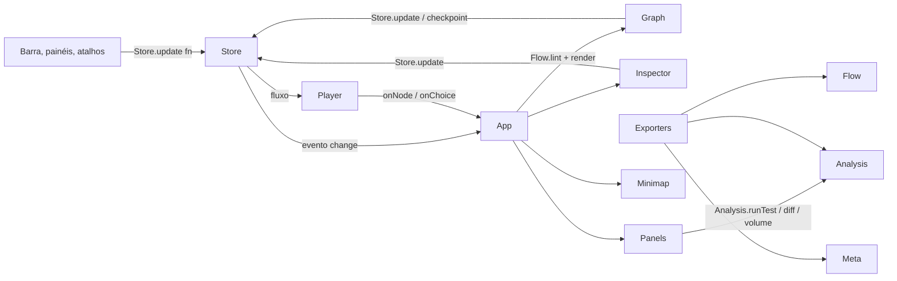

# Arquitetura — visão geral

Chatbot Mapper é um **monólito de página única**, sem build e sem dependências, aberto direto via `file://`. Cada arquivo em `js/` é um script clássico que publica um objeto global (`window.Flow`, `window.Store`…). Os módulos de domínio puro também exportam via `module.exports` para rodar nos testes do Node.

## Módulos

| Camada | Arquivo | Responsabilidade | Roda no Node |
|---|---|---|---|
| Domínio | `js/flow.js` | Schema, tipos de nó, portas/ligações, escopos (principal × subfluxo), migração, layout, lint, variáveis, regras | sim |
| Domínio | `js/analysis.js` | Motor de caminho (`runTest`), cobertura, diff de versões, caminhos e volume, pendências, colagem, mescla de revisão | sim |
| Domínio | `js/meta.js` | Limites e payloads da WhatsApp Cloud API | sim |
| Dados | `js/example.js` | Fluxo de exemplo genérico | sim |
| Estado | `js/store.js` | Fluxo atual, desfazer/refazer, autosave, versões salvas, área de transferência | não |
| Vista | `js/graph.js` | Canvas: faixas por grupo, nós, ligações, pan/zoom, seleção múltipla, realces | não |
| Vista | `js/minimap.js` | Minimapa do escopo atual | não |
| Vista | `js/search.js` | Busca e filtros | não |
| Vista | `js/inspector.js` | Painel Editar (nó ou fluxo) | não |
| Vista | `js/panels.js` | Abas Testes, Dados e Revisão | não |
| Autossuficiente | `js/player.js` | Simulador de conversa (embutido em exports via `toString()`) | não |
| Autossuficiente | `js/review.js` | Página de revisão do cliente (embutida via `toString()`) | não |
| Saída | `js/exporters.js` | JSON, Meta, Markdown, documento, especificação, pendências, simulador e revisão | não |
| Cola | `js/app.js` | Barra superior, abas, atalhos, arquivos | não |

## Fluxo de dados

- **Única fonte de verdade:** `Store.get()`. Toda mutação passa por `Store.update(fn, {source, coalesce})`, que tira snapshot para desfazer, agenda autosave e emite `change`.
- **Escopo do canvas:** o mapa mostra um escopo por vez (`null` = fluxo principal, ou o id de um subfluxo). `Flow.scopeNodes(flow, scope)` filtra; ligações nunca cruzam escopos, exceto via nó `call`.
- **Autossuficientes:** `ChatPlayer` e `ReviewPage` não podem referenciar nada fora da própria função, porque são serializados com `toString()` para gerar HTML de arquivo único.

## Decisões

Ver `docs/architecture/adr/`.
